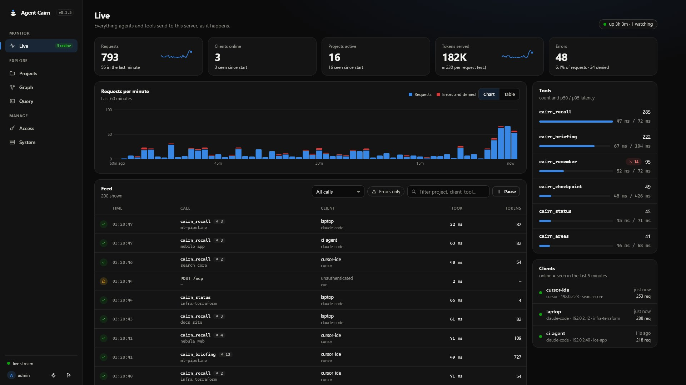
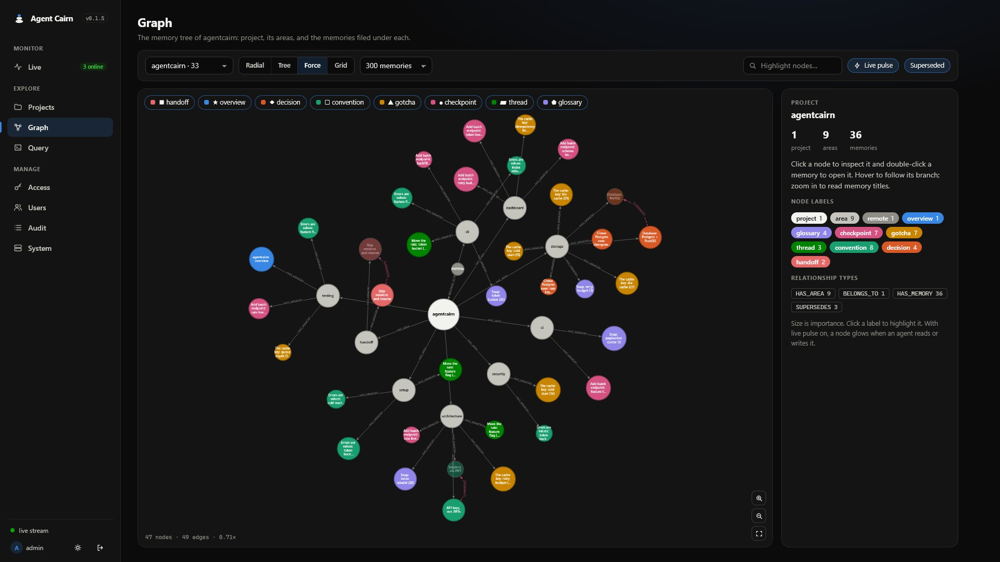
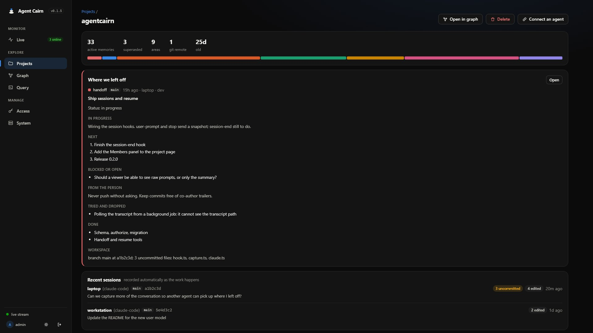
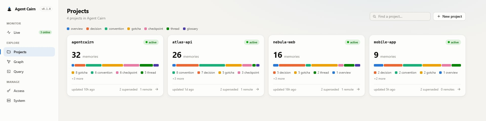
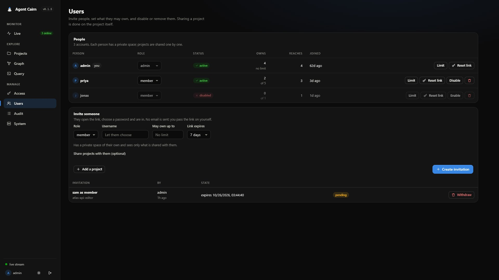

# Agent Cairn

**Shared, persistent project memory for AI coding agents.**

A cairn is a stack of stones that earlier hikers leave so the next one knows the way. Agent Cairn does that for agents: one records what it learned, the next one picks up the trail.

[](https://github.com/itsmemac/agentcairn/actions/workflows/ci.yml)
[](LICENSE)
[](package.json)

An AI agent that opens your project cold has to read files, guess conventions and ask you to explain things you have explained before, and it does that again on every new session, machine and account. Agent Cairn gives agents a **shared memory** stored in Neo4j: what the project is, how it is built, the traps that cost time, the decisions made and why. Any agent connecting through MCP starts from a compact, token-budgeted briefing instead of re-reading the repository.



## Why this exists

I built Agent Cairn because my laptop broke in the middle of a project.

Everything the agent and I had worked out together lived on that machine: the chat history, the memory files, the half-finished plan, the list of things we had already tried and thrown away. When I opened a new session on another computer, none of it came with me. The new agent was capable and willing, and knew nothing. I spent the first hours re-explaining the project, the decisions, the traps and exactly where we had stopped, and I still got it wrong in places, because I could not remember it all either.

Agent memory that lives on one machine is only as durable as that machine. A broken laptop, a second computer, a new account, a teammate: each one starts from zero, and the cost is paid in your time, not the agent's.

So the rule behind this project is simple: **whatever one agent learns, the next agent should be able to pick up, on any machine, exactly where the last one left off.** Memory sits on a server you own, in a database you can inspect. Sessions are recorded as they happen, so even an abrupt end loses very little. And before an agent stops, it writes a handoff: what is done, what is in progress, what comes next, what is blocked, and what was tried and dropped, so the next one does not walk down the same dead end.

Then it grew the pieces a team needs to trust it: private projects, sharing, roles and an audit trail.

## How it works

```
 Claude Code ──MCP over HTTP + token──►  Agent Cairn server  ──bolt──►  Neo4j
 (any machine,      hooks + CLI            (Docker)                  (graph)
  any account)                                │
                                         dashboard at /ui/
```

- **Agents write the memories.** Through MCP tools (`cairn_remember`, `cairn_checkpoint`) an agent records what it learns. The server never calls an LLM: no API key, no per-token cost, and it works with any MCP-capable agent.
- **Briefings instead of crawling.** `cairn_briefing` assembles the most important memories for a project within a token budget: overview, conventions, gotchas, open threads, recent checkpoints, decisions.
- **Another agent can pick up where you stopped.** Sessions are recorded as they happen (what you asked, the agent's last message, files, commits, uncommitted work), and the agent writes a handoff: done, in progress, next, blocked, tried and dropped. A new session, on any machine, opens with that and checks the repository against it. If your laptop dies, nothing has to be explained again. See [Handing work over](docs/claude-code.md#handing-work-over).
- **Memories know when they are stale.** Each memory records the commit and files it was written about. If those files have changed, the briefing flags it.
- **History is kept.** A changed fact *supersedes* the old one rather than overwriting it, so concurrent agents cannot clobber each other and the reasoning trail survives.
- **One memory per project, across machines.** A project is identified by an explicit id or by its (normalized, hashed) git remote, so every clone resolves to the same memory.
- **Private by default, shared on purpose.** Projects belong to the user who made them and can be shared with other users as viewer, editor or maintainer. See [Users, projects and access control](docs/access-control.md).
- **You can see what happens.** A built-in dashboard shows every request as it happens (to admins), the memory graph, and your projects, and lets you manage access.

## Quick start

You need Docker. Everything below runs on your own machine or server.

**1. Start the server and a Neo4j to go with it**

```bash
git clone https://github.com/itsmemac/agentcairn.git && cd agentcairn
cp .env.example .env                       # set NEO4J_PASSWORD
docker compose --profile with-neo4j up -d
docker compose logs cairn               # the first start prints a one-time setup code
```

Already running Neo4j? Set `NEO4J_URI` in `.env` and run `docker compose up -d cairn` instead.

**2. Create your admin account.** Open <http://localhost:8787/ui/>, enter the setup code from the log, choose a username and password. With one user the server is in *solo mode*: everything is yours and there is nothing else to set up.

**3. Connect Claude Code.** Do this on every computer that should use the memory.

You need [Claude Code](https://claude.com/claude-code), Node.js 20.12 or newer (for `npx`), and a token for that computer.

1. In the dashboard, open **Access → Create token** and copy the token. It is shown once, so create one per computer and name it after the machine.
2. Register the server with Claude Code. Replace the address with where your server is reachable from that computer, for example `http://192.168.0.40:8787`:

   ```bash
   claude mcp add cairn --scope user -e CAIRN_URL=http://localhost:8787 -e CAIRN_TOKEN=<token> -- npx -y agentcairn mcp
   ```

   It is one line on purpose, so it pastes the same into PowerShell, cmd, bash and zsh.

3. Check it, then restart Claude Code:

   ```bash
   claude mcp list          # cairn: ✓ Connected
   ```

That is the whole install. `--scope user` makes it available in every folder, and the project is taken from the folder's git remote (or its `.cairn.json`), so there is nothing to configure per repository. In Claude Code, ask it to call `cairn_status`. The first `cairn_briefing` of an empty project returns instructions that walk the agent through recording what it learns about the repository.

If `claude mcp add` says **"MCP server cairn already exists in user config"**, remove the old entry and add it again (this also updates the address or token):
It will not show in the Claude desktop app's server list (that lists only the desktop app's own servers); check with `claude mcp list` instead.

```bash
claude mcp remove cairn --scope user
```

More ways to connect, updating, uninstalling and troubleshooting are in [Using it with Claude Code](docs/claude-code.md).

**4. Optional: hooks and an explicit project id.** The `cairn` CLI (`npx -y agentcairn`) links a folder to a project and installs Claude Code hooks that inject the briefing at session start and remind the agent to checkpoint. See [Using it with Claude Code](docs/claude-code.md).

> The CLI is on npm as [`agentcairn`](https://www.npmjs.com/package/agentcairn). Run it with `npx -y agentcairn <command>`, or `npm install -g agentcairn` to get the `cairn` command.

## The dashboard

| | |
| --- | --- |
|  |  |
| **Graph**: every project as a bubble sized by what it remembers; click one to open its areas, double-click to explore its memories. Quiet projects fade, and nodes glow when an agent reads or writes them. | **A project**: where the work was left, the recent sessions, and every memory, sorted newest first by default. |





- **Live**: every request with its payload, latency and the memories it touched; throughput, per-tool latency, clients online. Admin only.
- **Projects** and **Graph**: browse, search, sort and explore the memories of the projects you can access; see the latest handoff and the recent sessions; follow supersede chains. Create a project, or delete one you own.
- **Query**: a read-only Cypher console. Admin only.
- **Access**: create and revoke your tokens, copy ready-made connection commands. An admin also sees everyone's.
- **System**: server and Neo4j health, graph size, security and capture settings. Admin only.

Dark and light themes, phone-friendly. Request payloads are kept **in memory only** (the last 2,000) and `Authorization` headers are never recorded.

## Users and sharing

Projects are **private to the user who made them**. A project has a generated id (`prj_…`) and a name; names may repeat. An owner can share a project with other users as a **viewer** (reads), **editor** (reads and writes), or **maintainer** (also deletes memories and manages members). Agent tokens act as the user who created them and can never do more than that user can. Two people working in the same repository each get their own project unless one shares theirs.

The model, the permission matrix and the rollout are in [Users, projects and access control](docs/access-control.md). An admin invites people from **Users** (a one-time link, no email server needed), can cap how many projects each may own, and sees every change in **Audit**. Owners share a project from its **Who has access** panel. Tokens can be read-only or limited to chosen projects.

## What agents get

| Tool | Purpose |
| --- | --- |
| `cairn_briefing` | Start here: a budgeted briefing that opens with where the last work stopped, or onboarding instructions for an empty project |
| `cairn_resume` | Pick up someone else's work: the full handoff, recent sessions, open threads, and how to check the repository |
| `cairn_handoff` | Write where the work stands (done, in progress, next, blocked, tried and dropped) so the next agent can carry on |
| `cairn_recall` | Search memories by text, kind and area |
| `cairn_remember` | Record a decision, convention, gotcha, overview, open thread or glossary term |
| `cairn_checkpoint` | Record a finished goal, its decisions, and what is next |
| `cairn_areas` | List the areas memories are filed under |
| `cairn_forget` | Delete a memory that was wrong |
| `cairn_status` | Health check: connection, project, counts |

## Documentation

- [Self-hosting](docs/self-hosting.md): Docker, TLS, upgrades, backups, troubleshooting
- [Unraid](docs/unraid.md): running it on an Unraid server
- [Using it with Claude Code](docs/claude-code.md): connecting, project identity, hooks
- [Users, projects and access control](docs/access-control.md): roles, sharing, how access is enforced
- [Configuration](docs/configuration.md): every setting and file
- [Architecture](docs/architecture.md): data model, briefings, staleness, security model
- [Contributing](CONTRIBUTING.md) · [Security policy](SECURITY.md) · [Changelog](CHANGELOG.md)

## Repository layout

| Package | What it is |
| --- | --- |
| [`packages/core`](packages/core) | Schema, memories, briefings, project identity, accounts and graph queries on Neo4j |
| [`packages/mcp-server`](packages/mcp-server) | The MCP server (HTTP, plus a local stdio mode), the JSON API and the dashboard |
| [`packages/cli`](packages/cli) | The `cairn` command and the Claude Code hooks |

## Development

```bash
npm install
cp .env.example .env     # point NEO4J_URI at a throwaway Neo4j (see CONTRIBUTING.md)
npm test                 # builds, then runs every package's tests
```

The integration tests run against a real Neo4j, so use a disposable instance. See [CONTRIBUTING.md](CONTRIBUTING.md).

## License

[MIT](LICENSE)
